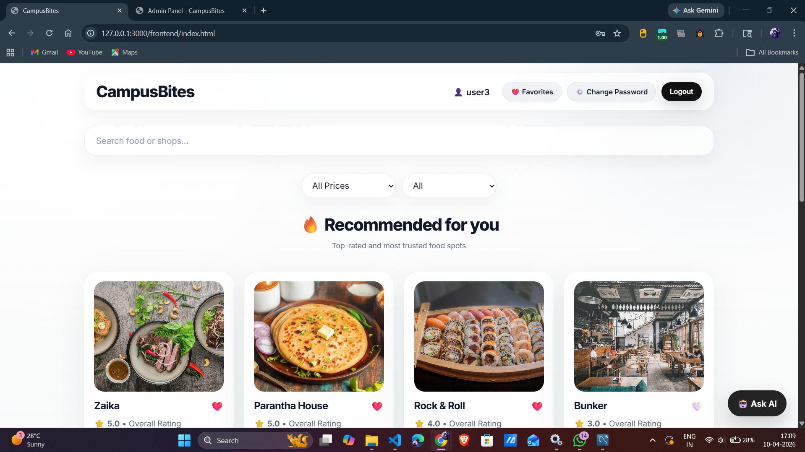
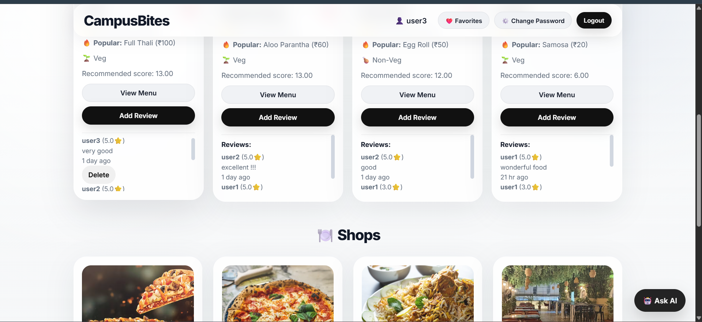
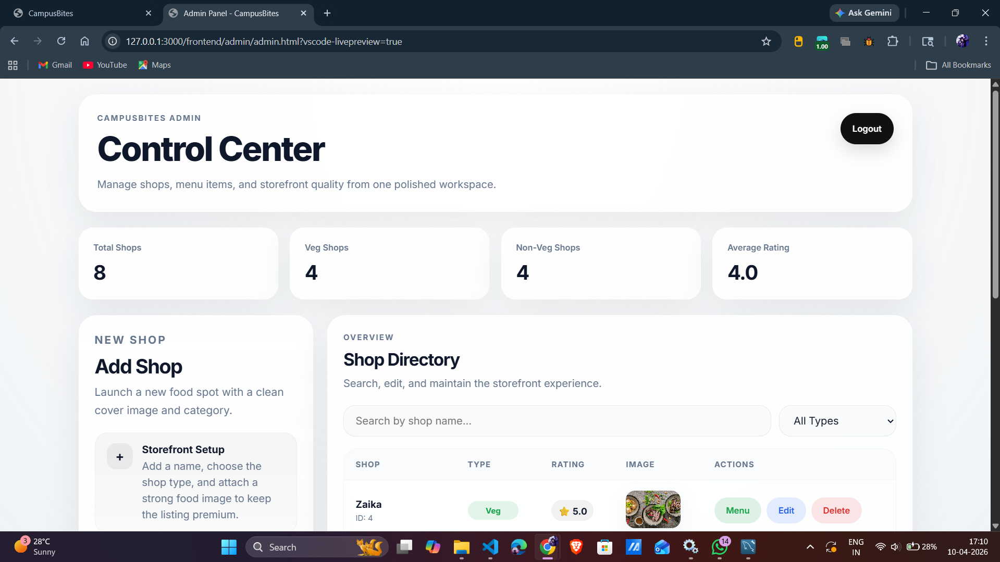
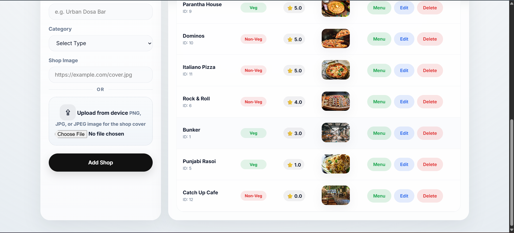

# CampusBites 

CampusBites is a full-stack campus food discovery platform that helps students quickly find nearby food outlets, explore menus, and make informed decisions using reviews, ratings, and personalized recommendations.

---

## Features

* Search food items and shop names with real-time filtering
* Personalized shop recommendations based on user activity
* Save favorite shops and menu items
* Rate and review shops with constraints (one review per day)
* Admin dashboard for managing shops, menus, and images

---

## Key Highlights

* Designed a relational database with multiple entities (users, shops, reviews, favorites)
* Implemented constraints like unique daily reviews and rating validation
* Built RESTful APIs using Node.js and Express.js
* Integrated bcrypt for secure password hashing
* Developed modular backend architecture (controllers, routes, services)

---

## Screenshots

### Home Page




### Admin Dashboard




---

## Tech Stack

* **Frontend:** HTML, CSS, JavaScript
* **Backend:** Node.js, Express.js
* **Database:** MySQL

---

## Project Structure

```text
CampusBites/
├── backend/
│   ├── app.js
│   ├── package.json
│   ├── controllers/
│   ├── db/
│   ├── routes/
│   ├── services/
│   ├── uploads/
│   └── utils/
├── database/
│   └── schema.sql
├── frontend/
│   ├── index.html
│   ├── login.html
│   ├── signup.html
│   ├── script.js
│   ├── style.css
│   └── admin/
│       ├── admin.html
│       ├── admin.js
│       ├── login.html
│       └── login.js
└── README.md
```

---

## Setup Instructions

### 1. Clone the repository

```bash
git clone <your-repo-url>
cd CampusBites
```

---

### 2. Set up the database

* Create a MySQL database named `campusbites`
* Import the SQL file:

```bash
mysql -u root -p < database/schema.sql
```

---

### 3. Install backend dependencies

```bash
cd backend
npm install
```

---

### 4. Start the backend server

```bash
npm start
```

Backend runs on:

```
http://localhost:5000
```

---

### 5. Open the frontend

Open in browser:

```
frontend/index.html
```

For admin panel:

```
frontend/admin/login.html
```

---

## Authentication Details

### Admin Login

* Username: `admin`
* Password: `1234`

### Sample Users

* Email: `user1@gmail.com` | Password: `user1`
* Email: `user2@gmail.com` | Password: `user2`
* Email: `user3@gmail.com` | Password: `user3`

> Note: Passwords are stored securely using bcrypt hashing.

---

## Why This Project?

This project solves a real-world problem faced by students in large campuses — difficulty in discovering food options efficiently. It demonstrates full-stack development, database design, and user-centric feature implementation.

---

## Notes

* Uploaded shop images are stored in `backend/uploads/`
* `node_modules/` is excluded via `.gitignore`
* Backend entry point: `backend/app.js`

---

## Future Improvements

* Enhanced recommendation system
* Improved mobile responsiveness
* Order placement and payment integration
* Deployment (cloud hosting)

---

## License

This project is for academic and personal use.
